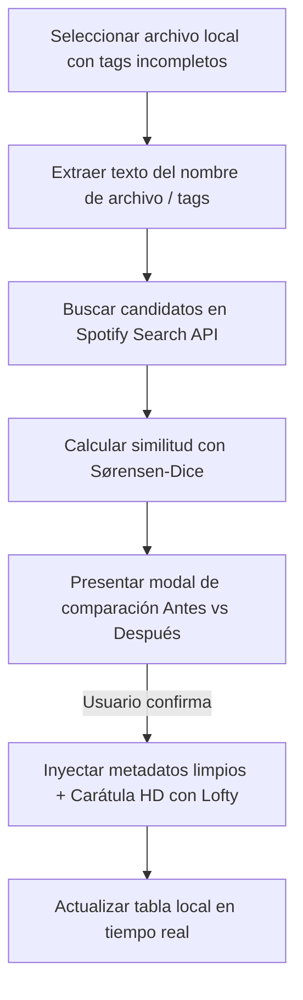
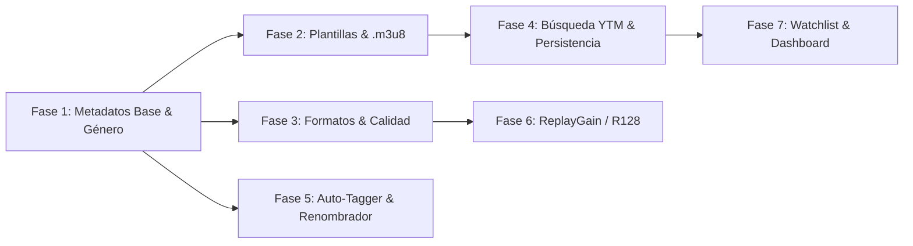

# 🚀 Plan Maestro de Mejoras e Implementaciones — Music Tools

Este documento detalla la hoja de ruta técnica y la arquitectura de implementación por fases para las futuras mejoras de **Music Tools**.
Cada fase está diseñada con especificaciones concretas de tipos, contratos de API entre Rust y TypeScript, estructuras de datos, manejo de errores y criterios de aceptación para garantizar una implementación modular, robusta y libre de regresiones.

---

## 📑 Tabla de Contenidos

1. [Fase 1: Enriquecimiento de Metadatos Base (Género, Nº de Pista, Fecha Completa, ISRC)](#fase-1-enriquecimiento-de-metadatos-base)
2. [Fase 2: Plantillas de Organización de Archivos y Generador `.m3u8`](#fase-2-plantillas-de-organización-de-archivos-y-generador-m3u8)
3. [Fase 3: Selector de Formatos y Calidad de Audio (MP3, FLAC, M4A, OPUS)](#fase-3-selector-de-formatos-y-calidad-de-audio)
4. [Fase 4: Priorización de Fuentes de Audio y Persistencia de Cola](#fase-4-priorización-de-fuentes-de-audio-y-persistencia-de-cola)
5. [Fase 5: Utilidades Locales Avanzadas (Auto-Tagger y Renombrado Masivo)](#fase-5-utilidades-locales-avanzadas-auto-tagger-y-renombrado-masivo)
6. [Fase 6: Normalización de Sonoridad (ReplayGain / EBU R128)](#fase-6-normalización-de-sonoridad-replaygain--ebu-r128)
7. [Fase 7: Mejoras del Reproductor, Estadísticas y Playlists en Observación (Watchlist)](#fase-7-mejoras-del-reproductor-estadísticas-y-playlists-en-observación-watchlist)

---

## Fase 1: Enriquecimiento de Metadatos Base

### 🎯 Objetivo
Extender la extracción y la inyección de metadatos para incluir:
* **Género musical (`genre`)**
* **Número de pistas y total de pistas (`track_number` / `track_total`)**
* **Fecha completa de lanzamiento (`release_date`)**
* **Código ISRC (`isrc`) e ID de Spotify (`spotify_id` en comentarios)**

---

### 📂 Archivos Involucrados
* `src/types/export-track.ts`
* `src/features/playlist/spotifyClient.ts` y `spotifyClient.test.ts`
* `src-tauri/src/downloader.rs`
* `src-tauri/src/scanner.rs`
* `src-tauri/src/lib.rs`
* `src/components/DownloadsPanel.tsx`
* `src/components/LocalUtilitiesPanel.tsx`
* `src/components/TrackPreviewTable.tsx`

---

### 🔧 1.1. Especificación de Tipos y Contratos

#### A. Frontend (`src/types/export-track.ts`)
```typescript
export type ExportTrack = {
  title: string;
  artists: string[];
  albumName?: string;
  albumImageUrl?: string;
  releaseDate?: string;     // Formato ISO: "YYYY-MM-DD" o "YYYY"
  duration?: string;
  genre?: string;           // Género principal o concatenado: "Synthpop, New Wave"
  trackNumber?: number;     // Número de pista dentro del álbum (ej: 1)
  trackTotal?: number;      // Total de pistas del álbum (ej: 12)
  isrc?: string;            // Código estándar internacional de grabación
  spotifyId?: string;       // ID único de la pista en Spotify
};
```

#### B. Backend Rust (`src-tauri/src/downloader.rs`)
```rust
pub fn write_mp3_tags(
    file_path: &str,
    title: &str,
    artists: &[String],
    album: Option<&str>,
    cover_data: Option<(&[u8], &str)>,
    year: Option<u32>,
    genre: Option<&str>,
    track_number: Option<u32>,
    track_total: Option<u32>,
    release_date: Option<&str>,
    isrc: Option<&str>,
    spotify_id: Option<&str>,
) -> Result<(), String>
```

---

### ⚙️ 1.2. Estrategia de Obtención de Géneros en Spotify API

> [!NOTE]
> La API oficial de Spotify no devuelve `genres` dentro del objeto `track`, sino en el objeto del **Artista** (`/v1/artists/{id}`) o en el **Álbum** (`/v1/albums/{id}`).

#### Algoritmo de Obtención por Lotes (Batching) y Cache:
1. Al cargar una playlist o álbum, recolectar todos los `artist_id` únicos de las canciones.
2. Agrupar los IDs en bloques de hasta 50 artistas (límite por llamada de `GET /v1/artists?ids=id1,id2,...`).
3. Almacenar los resultados en un mapa en memoria `Map<string, string[]>` (`artistId -> genres[]`).
4. Para cada canción, asignar el género más representativo del artista principal (capitalizado adecuadamente) o la lista de géneros concatenados por comas.
5. En caso de fallos de red o canciones sin género en Spotify, dejar el campo como `undefined` sin interrumpir el flujo.

```typescript
// src/features/playlist/spotifyClient.ts
export async function fetchArtistsGenresBatch(
  artistIds: string[],
  accessToken: string,
  fetcher: typeof fetch = fetch
): Promise<Map<string, string[]>> {
  const genreMap = new Map<string, string[]>();
  const uniqueIds = Array.from(new Set(artistIds.filter(id => Boolean(id))));
  
  const CHUNK_SIZE = 50;
  for (let i = 0; i < uniqueIds.length; i += CHUNK_SIZE) {
    const chunk = uniqueIds.slice(i, i + CHUNK_SIZE);
    const url = `https://api.spotify.com/v1/artists?ids=${chunk.join(",")}`;
    const response = await fetcher(url, {
      headers: { Authorization: `Bearer ${accessToken}` }
    });
    if (response.ok) {
      const data = await response.json();
      for (const artist of data.artists || []) {
        if (artist?.id && Array.isArray(artist.genres)) {
          genreMap.set(artist.id, artist.genres);
        }
      }
    }
  }
  return genreMap;
}
```

---

### 🦀 1.3. Inyección de Etiquetas en Rust con Lofty (`downloader.rs`)

```rust
use lofty::prelude::*;
use lofty::tag::ItemKey;

// Asignación de tags usando Lofty
tag.set_title(title.to_string());
tag.set_artist(artists.join(", "));

if let Some(alb) = album {
    if !alb.trim().is_empty() {
        tag.set_album(alb.to_string());
    }
}

if let Some(y) = year {
    tag.set_year(y);
}

if let Some(g) = genre {
    if !g.trim().is_empty() {
        tag.set_genre(g.to_string());
    }
}

if let Some(t_num) = track_number {
    tag.set_track(t_num);
}

if let Some(t_tot) = track_total {
    tag.set_track_total(t_tot);
}

if let Some(r_date) = release_date {
    if !r_date.trim().is_empty() {
        tag.insert_text(ItemKey::RecordingDate, r_date.to_string());
    }
}

if let Some(code) = isrc {
    if !code.trim().is_empty() {
        tag.insert_text(ItemKey::ISRC, code.to_string());
    }
}

if let Some(sp_id) = spotify_id {
    let comment_text = format!("MusicTools|SpotifyID:{}", sp_id);
    tag.set_comment(comment_text);
}
```

---

### 🔍 1.4. Lectura y Edición en Utilidades Locales (`scanner.rs`)

1. Modificar `extract_track_info` para devolver:
   ```rust
   pub struct ExtractedMetadata {
       pub title: Option<String>,
       pub artists: Vec<String>,
       pub album: Option<String>,
       pub year: Option<u32>,
       pub genre: Option<String>,
       pub track_number: Option<u32>,
       pub track_total: Option<u32>,
   }
   ```
2. Extender el struct `LocalTrack` para exponer estos campos hacia React.
3. Actualizar el modal de edición de etiquetas ID3 en `LocalUtilitiesPanel.tsx` con campos para:
    - Género
    - Número de pista (`# de ##`)
    - Año de lanzamiento

---

### ✅ Criterios de Aceptación de la Fase 1
- [ ] Las canciones descargadas desde una playlist de Spotify contienen Género, Número de Pista, Total de Pistas y Fecha Completa.
- [ ] Al abrir el archivo descargado en reproductores de audio (VLC, Mp3tag, Foobar2000), todos los metadatos se muestran en las columnas correspondientes.
- [ ] El escáner local reconoce el género y el número de pistas de los archivos existentes.
- [ ] El modal de edición de tags permite modificar y guardar el género y la pista sin corromper el archivo.
- [ ] Los tests unitarios de `spotifyClient.test.ts` validan la correcta extracción y mapeo de los nuevos campos.

---

## Fase 2: Plantillas de Organización de Archivos y Generador `.m3u8`

### 🎯 Objetivo
Permitir al usuario configurar cómo y dónde se organizan los archivos descargados mediante plantillas de nombres y carpetas, además de generar automáticamente un archivo de lista de reproducción `.m3u8` compatible con cualquier reproductor.

---

### 📂 Archivos Involucrados
* `src/utils/settings.ts`
* `src/components/SettingsDialog.tsx`
* `src-tauri/src/downloader.rs`
* `src-tauri/src/lib.rs`
* `src/components/DownloadsPanel.tsx`

---

### 🔧 2.1. Configuración de Plantillas de Carpetas (`settings.ts`)

```typescript
export type FolderOrganizationMode = 
  | "flat"                  // Descargas/Artista - Titulo.mp3
  | "by_artist"             // Descargas/Artista/Titulo.mp3
  | "by_artist_album"       // Descargas/Artista/Album/01 - Titulo.mp3
  | "by_playlist"           // Descargas/NombrePlaylist/Artista - Titulo.mp3
  | "custom";               // Patron personalizado por el usuario

export type AppSettings = {
  // ... campos existentes
  folderOrganizationMode: FolderOrganizationMode;
  customNamingTemplate: string; // Ej: "{artist}/{album}/{track:02d} - {title}"
  generateM3u8Playlist: boolean;
  m3u8RelativePaths: boolean;
};
```

---

### ⚙️ 2.2. Motor de Sustitución y Sanitización de Rutas en Rust (`downloader.rs`)

#### Variables disponibles para la plantilla:
| Variable      | Descripción                                   | Ejemplo                  |
|:--------------|:----------------------------------------------|:-------------------------|
| `{artist}`    | Artista principal o artistas unidos por comas | `Daft Punk`              |
| `{title}`     | Título de la canción                          | `Get Lucky`              |
| `{album}`     | Nombre del álbum                              | `Random Access Memories` |
| `{track}`     | Número de pista sin ceros iniciales           | `8`                      |
| `{track:02d}` | Número de pista con 2 dígitos                 | `08`                     |
| `{year}`      | Año de lanzamiento                            | `2013`                   |
| `{genre}`     | Género musical                                | `Disco`                  |
| `{playlist}`  | Nombre de la lista de reproducción origen     | `Favoritos 2013`         |

#### Función de Sanitización Multiplataforma:
```rust
pub fn sanitize_path_segment(input: &str) -> String {
    let invalid_chars = ['<', '>', ':', '"', '/', '\\', '|', '?', '*'];
    let mut cleaned: String = input
        .chars()
        .map(|c| if invalid_chars.contains(&c) || c.is_control() { '_' } else { c })
        .collect();
    
    // Evitar nombres reservados en Windows (CON, PRN, AUX, NUL, COM1, LPT1, etc.)
    let upper = cleaned.to_uppercase();
    if ["CON", "PRN", "AUX", "NUL", "COM1", "COM2", "COM3", "LPT1", "LPT2"].contains(&upper.as_str()) {
        cleaned.push('_');
    }
    
    cleaned.trim().to_string()
}
```

#### Resolución de la Ruta Final:
1. Reemplazar cada variable sanitizando su contenido.
2. Construir la ruta combinando `download_base_dir` con los subdirectorios generados.
3. Llamar a `std::fs::create_dir_all(&parent_dir)` para crear automáticamente los subdirectorios necesarios (`Artista/Álbum/`).

---

### 📜 2.3. Generador de Archivos `.m3u8` (`downloader.rs`)

Al finalizar la descarga de una lista o lote, si la opción `generateM3u8Playlist` está activada:

```rust
#[tauri::command]
pub fn create_m3u8_playlist(
    playlist_name: String,
    target_dir: String,
    tracks: Vec<M3u8TrackEntry>,
) -> Result<String, String> {
    let safe_name = sanitize_path_segment(&playlist_name);
    let m3u8_path = Path::new(&target_dir).join(format!("{}.m3u8", safe_name));
    
    let mut content = String::from("#EXTM3U\n");
    content.push_str(&format!("#PLAYLIST:{}\n\n", playlist_name));
    
    for track in tracks {
        let duration_secs = track.duration_seconds.unwrap_or(-1);
        content.push_str(&format!(
            "#EXTINF:{},{} - {}\n{}\n\n",
            duration_secs,
            track.artist,
            track.title,
            track.relative_file_path
        ));
    }
    
    fs::write(&m3u8_path, content.as_bytes())
        .map_err(|e| format!("Error al escribir archivo .m3u8: {e}"))?;
        
    Ok(m3u8_path.to_string_lossy().to_string())
}
```

---

### ✅ Criterios de Aceptación de la Fase 2
- [ ] El usuario puede seleccionar un modo de organización en Ajustes y las descargas respetan la estructura de carpetas configurada.
- [ ] Los nombres de carpetas y archivos con caracteres conflictivos (`/`, `:`, `?`, `"`, etc.) se sanean correctamente sin generar errores de sistema de archivos en Windows ni Linux.
- [ ] Al finalizar un lote de descargas, se genera el archivo `.m3u8` con codificación UTF-8.
- [ ] El archivo `.m3u8` puede ser abierto en VLC Media Player o cualquier reproductor multimedia reproduciendo las pistas en el orden exacto.

---

## Fase 3: Selector de Formatos y Calidad de Audio

### 🎯 Objetivo
Permitir al usuario seleccionar el formato contenedor de salida (`MP3`, `FLAC`, `M4A`, `OPUS`) y la tasa de bits / calidad de audio deseada.

---

### 📂 Archivos Involucrados
* `src/utils/settings.ts`
* `src/components/SettingsDialog.tsx`
* `src-tauri/src/downloader.rs`
* `src/components/DownloadsPanel.tsx`

---

### 🔧 3.1. Configuración de Formatos y Bitrate

```typescript
export type AudioOutputFormat = "mp3" | "flac" | "m4a" | "opus";

export type AudioQualityPreset = 
  | "320k"    // MP3 / M4A Máxima calidad CBR
  | "256k"    // Calidad estándar alta
  | "192k"    // Calidad equilibrada
  | "v0_vbr"  // MP3 Variable Bitrate V0 (óptima relación peso/calidad)
  | "lossless"; // Para FLAC (sin compresión destructiva)

export type AppSettings = {
  // ...
  audioOutputFormat: AudioOutputFormat;
  audioQuality: AudioQualityPreset;
};
```

---

### ⚙️ 3.2. Argumentos de Conversión en `yt-dlp` y `ffmpeg`

En `src-tauri/src/downloader.rs`, adaptar la construcción del comando `yt-dlp`:

```rust
let (audio_format, audio_quality_arg) = match (format_setting.as_str(), quality_setting.as_str()) {
    ("flac", _) => ("flac", "0"),
    ("m4a", "320k") => ("m4a", "320k"),
    ("m4a", "256k") => ("m4a", "256k"),
    ("m4a", _) => ("m4a", "192k"),
    ("opus", _) => ("opus", "0"),
    ("mp3", "320k") => ("mp3", "320k"),
    ("mp3", "256k") => ("mp3", "256k"),
    ("mp3", "192k") => ("mp3", "192k"),
    ("mp3", "v0_vbr") => ("mp3", "0"),
    _ => ("mp3", "320k"),
};

cmd.arg("-x")
   .arg("--audio-format").arg(audio_format)
   .arg("--audio-quality").arg(audio_quality_arg);
```

---

### 🏷️ 3.3. Compatibilidad de Etiquetas según Formato en Lofty

Lofty soporta etiquetar múltiples formatos. Se debe asegurar el tipo de tag correcto según la extensión:

```rust
let tag_type = match extension {
    "mp3" => TagType::Id3v2,
    "flac" | "ogg" | "opus" => TagType::VorbisComments,
    "m4a" | "mp4" | "aac" => TagType::Mp4Ilst,
    _ => TagType::Id3v2,
};
```

---

### ✅ Criterios de Aceptación de la Fase 3
- [ ] La selección de `FLAC` genera archivos `.flac` con etiquetas Vorbis Comments válidas y carátula incrustada.
- [ ] La selección de `M4A` genera archivos `.m4a` con etiquetas MP4 Ilst compatibles con iTunes / Apple Music.
- [ ] La descarga en MP3 320 kbps genera un archivo con bitrate constante verificado con `ffprobe` o `mediainfo`.
- [ ] Si `ffmpeg` no está instalado en el sistema, la UI muestra una advertencia clara antes de iniciar las descargas.

---

## Fase 4: Priorización de Fuentes de Audio y Persistencia de Cola

### 🎯 Objetivo
Mejorar la precisión del audio descargado (evitando versiones con introducciones habladas o videoclips) y permitir que la cola de descargas sobreviva al reinicio de la aplicación.

---

### 📂 Archivos Involucrados
* `src-tauri/src/downloader.rs`
* `src/components/DownloadsPanel.tsx`
* `src/utils/settings.ts`

---

### 🔍 4.1. Búsqueda Optimizada con YouTube Music

`yt-dlp` soporta el prefijo `ytmsearch:` (YouTube Music), el cual prioriza pistas de estudio oficiales con audio masterizado frente a videos de YouTube convencional:

```rust
// Estrategia de búsqueda en downloader.rs
let search_query = if use_youtube_music_search {
    format!("ytmsearch1:{} - {}", artist, title)
} else {
    format!("ytsearch1:{} - {} Official Audio", artist, title)
};
```

#### Mecanismo de Respaldo (Fallback):
1. Intentar la búsqueda inicial con `ytmsearch1:`.
2. Si `yt-dlp` devuelve error de contenido no disponible o sin resultados, ejecutar un segundo intento transparente con `ytsearch1:`.

---

### 💾 4.2. Persistencia y Recuperación de la Cola de Descargas

#### Estructura de Almacenamiento Local (`localStorage` / Archivo JSON de Sesión):
```typescript
type PersistedQueueState = {
  version: number;
  timestamp: number;
  playlistName: string;
  folderPath: string;
  tracks: QueueTrack[];
};
```

#### Ciclo de Vida:
1. Cada vez que cambia el estado de la cola (`waiting`, `downloading`, `completed`, `failed`), guardar el estado serializado.
2. Al abrir `DownloadsPanel`, si existe una cola previa con canciones en estado `waiting` o `failed`, mostrar un banner:
   > *"Tienes una sesión de descargas anterior con 24 canciones pendientes. ¿Deseas reanudarla?"*
3. Botones: `[Reanudar Sesión]` / `[Descartar]`.

---

### ✅ Criterios de Aceptación de la Fase 4
- [ ] Las canciones descargadas mediante `ytmsearch1:` corresponden a las versiones de estudio sin ruidos de video.
- [ ] Al forzar el cierre de la aplicación (o corte de energía) durante una descarga masiva, las canciones pendientes pueden recuperarse y reanudarse con 1 clic.
- [ ] Las canciones ya completadas en disco se detectan automáticamente y no se descargan por duplicado.

---

## Fase 5: Utilidades Locales Avanzadas (Auto-Tagger y Renombrado Masivo)

### 🎯 Objetivo
Transformar el módulo de Utilidades Locales en un gestor integral de biblioteca, permitiendo corregir metadatos automáticamente desde Spotify y renombrar archivos en disco masivamente.

---

### 📂 Archivos Involucrados
* `src/components/LocalUtilitiesPanel.tsx`
* `src/features/playlist/spotifyClient.ts`
* `src-tauri/src/scanner.rs`
* `src-tauri/src/lib.rs`

---

### 🪄 5.1. Auto-Tagger Inteligente ("Fix Metadata with Spotify")

#### Flujo de Funcionamiento:


#### Modal de Comparación Antes vs. Después:
* **Antes:** `track_03_rock_audiomaster.mp3` | Artista: Desconocido | Álbum: Desconocido | Sin carátula
* **Después:** `Money for Nothing` | Artista: Dire Straits | Álbum: Brothers in Arms | Género: Classic Rock | Carátula HD (640x640) | Pista #02

---

### ✏️ 5.2. Renombrado Masivo de Archivos Físicos (Batch Renamer)

Permite actualizar los nombres de los archivos en el disco duro según los tags ID3 que ya tienen incrustados:

#### Comando en Rust (`lib.rs` / `scanner.rs`):
```rust
#[derive(serde::Deserialize)]
pub struct RenameOperation {
    pub old_path: String,
    pub new_path: String,
}

#[tauri::command]
pub fn batch_rename_files(operations: Vec<RenameOperation>) -> Result<usize, String> {
    let mut renamed_count = 0;
    for op in operations {
        let old_p = Path::new(&op.old_path);
        let new_p = Path::new(&op.new_path);
        
        if old_p.exists() && !new_p.exists() {
            if let Some(parent) = new_p.parent() {
                let _ = fs::create_dir_all(parent);
            }
            if fs::rename(old_p, new_p).is_ok() {
                renamed_count += 1;
            }
        }
    }
    Ok(renamed_count)
}
```

---

### 🖼️ 5.3. Buscador de Carátulas Huérfanas (Missing Artwork Finder)

1. En `LocalUtilitiesPanel`, agregar un filtro: `Mostrar sólo archivos sin carátula`.
2. Botón `Buscar carátulas automáticamente`:
    - Busca en Spotify por `Artista` y `Álbum`.
    - Descarga la imagen en memoria y la inyecta mediante `write_mp3_tags` sin modificar el audio.

---

### ✅ Criterios de Aceptación de la Fase 5
- [ ] El Auto-Tagger encuentra coincidencias precisas para canciones con nombres desordenados.
- [ ] La previsualización de renombramiento masivo muestra advertencias si dos archivos generarían el mismo nombre de destino.
- [ ] La inyección de carátulas huérfanas no altera la fecha de creación original del archivo más de lo necesario y actualiza la UI de inmediato.

---

## Fase 6: Normalización de Sonoridad (ReplayGain / EBU R128)

### 🎯 Objetivo
Calcular e inyectar etiquetas de ganancia de audio (ReplayGain / LUFS) para que todas las canciones de la biblioteca se reproduzcan con un volumen uniforme sin alterar la fidelidad de la pista de audio original.

---

### 📂 Archivos Involucrados
* `src-tauri/src/scanner.rs`
* `src-tauri/src/downloader.rs`
* `src/components/LocalUtilitiesPanel.tsx`

---

### ⚙️ 6.1. Cálculo de Ganancia con FFmpeg

FFmpeg incluye el filtro `ebur128` que mide el nivel de sonoridad integrado según el estándar ITU-R BS.1770 / EBU R128:

```bash
ffmpeg -i "cancion.mp3" -af ebur128=framelog=verbose -f null -
```

#### Extracción del valor de ganancia:
* **Objetivo estándar:** `-18 LUFS` (ReplayGain 2.0) o `-14 LUFS` (Spotify Target).
* Si una canción se mide en `-12 LUFS`, su etiqueta de ganancia será `REPLAYGAIN_TRACK_GAIN = -6.00 dB`.

---

### 🏷️ 6.2. Inyección de Tags ReplayGain con Lofty

```rust
// Tags estándar ID3v2 TXXX para ReplayGain
tag.insert_text(ItemKey::Unknown("REPLAYGAIN_TRACK_GAIN".to_string()), format!("{:.2} dB", track_gain));
tag.insert_text(ItemKey::Unknown("REPLAYGAIN_TRACK_PEAK".to_string()), format!("{:.6}", track_peak));
```

---

### ✅ Criterios de Aceptación de la Fase 6
- [ ] La ganancia se inyecta como metadata y **no recodifica** el archivo de audio (cero pérdida de calidad).
- [ ] Reproductores compatibles con ReplayGain (como Foobar2000 o Poweramp) nivelan el volumen automáticamente.

---

## Fase 7: Mejoras del Reproductor, Estadísticas y Playlists en Observación (Watchlist)

### 🎯 Objetivo
Añadir controles avanzados al reproductor integrado, métricas de biblioteca y seguimiento automático de playlists de Spotify.

---

### 📂 Archivos Involucrados
* `src/components/AudioPlayer.tsx`
* `src/components/TopBar.tsx`
* `src/components/LocalUtilitiesPanel.tsx`
* `src/features/playlist/spotifyClient.ts`

---

### 🎛️ 7.1. Controles Avanzados en `AudioPlayer.tsx`

1. **Velocidad de Reproducción (Playback Rate):**
    - Opciones: `0.75x`, `1.0x`, `1.25x`, `1.5x`.
    - Implementación: `sourceNodeRef.current.playbackRate.value = rate;`.
2. **Ecualizador de 3 Bandas (Web Audio API):**
    - Graves (`BiquadFilterNode` tipo `lowshelf`, 100 Hz).
    - Medios (`BiquadFilterNode` tipo `peaking`, 1000 Hz).
    - Agudos (`BiquadFilterNode` tipo `highshelf`, 8000 Hz).

---

### 👁️ 7.2. Sistema de Playlists en Observación ("Watchlist")

Permite guardar listas de Spotify que se actualizan frecuentemente (ej. *Discover Weekly*, *Top 50*, o playlists personales colaborativas):

1. Guardar IDs de playlists en la lista de seguimiento.
2. Botón en la barra superior o diálogo de estado: `Comprobar Novedades`.
3. La aplicación compara las pistas remotas actuales contra la biblioteca local y abre directamente en el **Staging Workspace** únicamente las canciones que no han sido descargadas aún.

---

### 📈 7.3. Dashboard de Estadísticas de la Biblioteca

Panel visual dentro de Utilidades Locales que calcula:
* **Espacio Total:** GB ocupados por la biblioteca de música.
* **Distribución de Formatos:** Gráfico de porcentaje (ej: 78% MP3, 15% FLAC, 7% M4A).
* **Distribución por Géneros:** Top 5 de géneros más descargados (Rock, Pop, Synthwave...).
* **Top Artistas:** Los 10 artistas con mayor número de canciones en disco.

---

### ✅ Criterios de Aceptación de la Fase 7
- [ ] El cambio de velocidad en el reproductor funciona sin alterar el tono o distorsionar la señal.
- [ ] La Watchlist detecta adiciones en playlists remotas y permite descargarlas con un solo clic.
- [ ] El Dashboard de estadísticas genera métricas instantáneas a partir del escáner en Rust sin congelar la interfaz.

---

## 🗺️ Resumen de Fases y Dependencias



Este plan modular permite implementar cada fase de manera independiente, validando con pruebas unitarias y manuales antes de continuar con la siguiente, garantizando la estabilidad continua de **Music Tools**.
